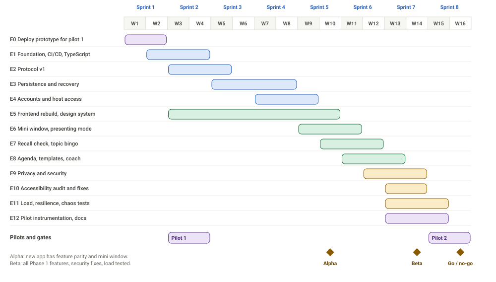

# Engage: Engineering Plan

| | |
|---|---|
| **Document status** | Draft v0.1, for review |
| **Date** | 13 October 2026 |
| **Audience** | Engineering, product, delivery |
| **Scope** | Turning the prototype into a pilot-ready product (Phase 1.5), then the start of Phase 2 |
| **Related** | `docs/architecture/technical-architecture.md`, `docs/PRD.md`, `docs/design/Engage-UX-UI-Design.pdf` |

---

## 1. Summary

The prototype covers the core product. This plan turns it into something a company can pilot with confidence, adds the features still missing (mini window, presenting mode, recall check, agenda and coach), and prepares for in-meeting apps.

- **Duration:** 16 weeks (8 two-week sprints) with a team of about 2.5 engineers.
- **Effort:** about 31 person-weeks across 13 epics, against about 40 available (22% buffer).
- **Pilot early:** pilot 1 runs in weeks 3 and 4 on the *existing* prototype, deployed properly. Real data arrives before most of the rebuild is done.
- **Gates:** four decision points, with explicit criteria (section 5).
- **Confidence:** estimates are plus or minus 40%. The largest uncertainties are the front-end rebuild, picture-in-picture behaviour, and platform approval times (Phase 2).

## 2. Team and assumptions

| Role | Share | Main work |
|---|---|---|
| Backend and platform engineer | 1.0 | Server, data, realtime, infrastructure, security |
| Frontend engineer | 1.0 | React app, design system, mini window, accessibility |
| Flex engineer (design engineer or QA) | 0.5 | Components, end-to-end tests, load tests, pilot support |
| Designer | 0.5 | Remaining screens, test sessions, design review |
| Product manager | 0.5 | Pilots, priorities, gates, customer contact |

**Assumptions.** The team starts at week 1 with the prototype and docs in this repository. A pilot company and three pilot hosts are found by week 2. The first platform for in-meeting apps is chosen by week 12. Estimates are for a team already familiar with TypeScript, React and Postgres. If not, add 15 to 20%.

**Capacity.** 2.5 engineers × 16 weeks = 40 person-weeks. Planned work is 31. The rest covers holidays, sick time, reviews, interruptions and estimate error.

## 3. How we work

- **Trunk-based development.** Short-lived branches. Pull requests under about 400 lines. Merge when CI is green and one other person has reviewed.
- **Feature flags** for anything risky or unfinished, so the main branch is always deployable.
- **Weekly releases at least**, to staging every merge, to production on demand.
- **Definition of ready.** A ticket has a user outcome, acceptance criteria, a design reference if it touches UI, and an estimate of 5 days or less.
- **Definition of done:**
    1. Acceptance criteria met and demonstrated.
    2. Tests added at the right level. Types check. Lint passes.
    3. For UI: keyboard and screen reader check, light and dark checked, no console errors.
    4. Logging and metrics added where behaviour is important, with no meeting content in logs.
    5. Privacy check: does this store or show new personal data? If yes, update the data table and the join disclosure.
    6. Deployed to staging and smoke tested.
    7. Docs updated.
- **Decisions** are written as short ADRs in the repository.
- **Demos** at the end of each sprint, with the product manager and, when possible, a pilot host.

## 4. Epics

| ID | Epic | Scope | Lead | Person-weeks | Depends on | Done when |
|---|---|---|---|---|---|---|
| **E0** | Pilot deployment of the prototype | Host the current app with HTTPS, a domain, a health check, uptime alert, privacy note, survey link, host-link stop-gap | Backend | 1.0 | none | Three pilot hosts can run meetings on a stable URL |
| **E1** | Foundation | Workspace layout, TypeScript, CI, lint, local environment with Postgres and Redis, preview deploys, infrastructure as code, observability basics | Backend | 3.0 | none | New code builds, tests and deploys by itself on every merge |
| **E2** | Protocol v1 | Shared schemas, validation on both ends, versioned envelope, message ids, sequence numbers | Backend | 2.0 | E1 | No unvalidated message reaches the domain. Contract tests pass |
| **E3** | Persistence and recovery | Schema and migrations, batched event log, snapshots, recovery after a node loss, retention job | Backend | 3.5 | E2 | Killing a node mid-meeting recovers within 15 seconds. Old data deleted on schedule |
| **E4** | Accounts and host access | Managed sign-in, host sessions, meeting ownership, host console from any browser | Backend | 2.5 | E1 | A host signs in on another computer and reaches the live meeting |
| **E5** | Front-end rebuild and design system | React app, tokens, components, host console, attendee app, light and dark, accessibility baseline | Frontend | 4.5 | E1, E2 | New app matches the current features and passes accessibility scan |
| **E6** | Mini window and presenting mode | Floating window, pill and card, first-use note, presenting switch, fallbacks, spike on browser behaviour | Frontend | 2.5 | E5, SP-1 | Works in Chrome and Edge. Fallback works in Safari and Firefox |
| **E7** | Recall check and games update | Recall check with "Missed that", 15-minute cap, host launcher and results, topic bingo, closing takeaway | Frontend | 2.0 | E5 | Recall check usable by pilot hosts. Results match the design |
| **E8** | Agenda, templates and coach | Agenda editor, segment chart, templates, host coach summary | Frontend | 3.0 | E3, E5 | Host builds an agenda and sees the coach summary after a meeting |
| **E9** | Privacy and security hardening | Threat model fixes, session security, rate limits per address, deletion flow, privacy summary, independent review preparation | Backend | 2.0 | E4 | No open high findings. Host can delete a meeting and all its data |
| **E10** | Accessibility audit and fixes | Automated and manual audit, fixes, screen reader pass | Frontend | 1.5 | E5, E6, E7 | No serious issues. Keyboard and screen reader journeys pass |
| **E11** | Load, resilience and chaos testing | Scenarios, tooling, results, fixes | Flex | 2.0 | E3, E5 | Pass criteria in the architecture document met |
| **E12** | Pilot instrumentation and documentation | Privacy-safe metrics, survey, dashboards, runbooks, host guide | Flex | 1.5 | E1 | Pilot 2 metrics and survey available without manual work |
| | **Total** | | | **31.0** | | |

**Sequencing notes**

- E3 waits for E2 because events carry the validated message types.
- E6 needs the spike (SP-1) and the shared components from E5.
- E8 needs persistence (E3), because agenda segments and summaries are stored.
- E9 needs accounts (E4) because sessions are the main change.

## 5. Timeline and gates

| Sprint | Weeks | Focus | Demo at the end |
|---|---|---|---|
| 1 | 1 to 2 | E0, E1 start, hosting decision | Prototype running on a real URL. CI on every pull request |
| 2 | 3 to 4 | E1, E2, E5 start. **Pilot 1** (existing app) | First real meetings. Typed domain model with validated protocol |
| 3 | 5 to 6 | E3 start, E5 attendee app | Events and snapshots in Postgres. New attendee app joins a real meeting |
| 4 | 7 to 8 | E3, E4, E5 host console | Kill a node and watch recovery. Sign in from a second browser |
| 5 | 9 to 10 | E5 finish, E6, E7 start | **Alpha:** new app has parity, with the mini window |
| 6 | 11 to 12 | E7, E8, E9 start | Recall check, agenda and coach in the new app |
| 7 | 13 to 14 | E9, E10, E11, E12 | **Beta:** all Phase 1 features, accessibility pass, load test results |
| 8 | 15 to 16 | Buffer, fixes, **Pilot 2** (10 or more meetings) | Go or no-go for Phase 2 |

### Gates

| Gate | When | Criteria | If not met |
|---|---|---|---|
| **G1** After pilot 1 | Week 4 | Participation, distraction and repeat intent measured from three real meetings. No critical incident | Adjust the interaction design before the mini window and recall check are built |
| **G2** Alpha | Week 10 | New app matches the old one. Mini window works in Chrome and Edge. Recovery test passes in staging | Delay new features. Fix parity first |
| **G3** Beta | Week 14 | All Phase 1 features. Load test passes. No open high security finding. Accessibility scan clean | Use the week 15 and 16 buffer. Cut scope (below) |
| **G4** Phase 2 | Week 16 | Pilot 2 shows participation of 70% or more and distraction of 10% or less, reliability 95% or more, a pilot company willing to continue | Stay on the web app. Improve the interaction before building platform apps |

### Scope levers, in the order to cut

1. Templates.
2. Topic bingo and closing takeaway.
3. A simpler coach summary (two insights, no history).
4. Magic link only for host sign-in (skip Microsoft or Google).
5. A basic agenda (list only, no drag editing).

**Never cut:** persistence, deletion, security fixes, accessibility audit, presenting mode, load and recovery tests.

## 6. Sprint backlog (sprints 1 to 3)

Estimates are in working days for one person.

### Sprint 1 (weeks 1 to 2)

| ID | Ticket | Owner | Days | Acceptance |
|---|---|---|---|---|
| ENG-001 | Deploy the prototype to a managed platform with HTTPS and a domain | Backend | 2 | Reachable URL over HTTPS. Health check. Restarts on failure |
| ENG-002 | Uptime check, error capture and an alert to chat | Backend | 1 | An outage triggers an alert within 2 minutes |
| ENG-003 | Link a short privacy note on the join screen and a survey link after the meeting | Frontend | 1 | Both links work. Survey link is configurable |
| ENG-004 | Stop-gap: let the host copy a private host link that reopens the console | Frontend | 1 | Opening the link on another browser restores host control |
| ENG-005 | Workspace layout with `shared`, `server`, `web` packages | Backend | 2 | `npm test` and `npm start` still work |
| ENG-006 | TypeScript config that allows JavaScript, strict for new files, type check in CI | Backend | 1 | A type error fails the build |
| ENG-007 | CI on every pull request: lint, tests, build | Backend | 2 | Required check. Under 5 minutes |
| ENG-008 | Lint, formatting and pre-commit hooks | Backend | 1 | Consistent style enforced |
| SP-6 | Hosting comparison and decision (managed platform, AWS) | Backend | 1 | Short ADR with the choice |

### Sprint 2 (weeks 3 to 4)

| ID | Ticket | Owner | Days | Acceptance |
|---|---|---|---|---|
| ENG-009 | Port the meeting domain model to TypeScript | Backend | 4 | All 21 unit tests pass unchanged |
| ENG-010 | Shared message schemas for every client and server message | Backend | 3 | One package imported by server and web |
| ENG-011 | Validate every incoming message. Count and drop invalid ones | Backend | 2 | Fuzz test does not crash the server |
| ENG-012 | Contract tests: no snapshot contains another viewer's data | Backend | 2 | Fails if a leak is introduced |
| ENG-013 | Design tokens and base components (button, chip, card, banner, tabs, switch, input) | Frontend | 5 | Match the design system. Light and dark. Keyboard support |
| ENG-014 | App shell: routing, theming, text files for translation | Frontend | 3 | Landing and join routes render |
| ENG-015 | Pilot 1 support: watch meetings, fix blockers | Both | 3 | Blocking issues fixed within a day |
| ENG-016 | Local environment with Postgres and Redis in containers | Backend | 2 | One command starts everything |
| ENG-025 | End-to-end smoke journey: host plus three attendees, answer a poll, Focus, end | Flex | 3 | Runs in CI |
| SP-2 | Baseline load test on the prototype (200 clients) | Flex | 2 | Numbers recorded for comparison |

### Sprint 3 (weeks 5 to 6)

| ID | Ticket | Owner | Days | Acceptance |
|---|---|---|---|---|
| ENG-017 | Postgres schema and migrations | Backend | 4 | Matches the data model. Migrations run in CI |
| ENG-018 | Batched event writer with sequence numbers | Backend | 3 | At most 1 second of lag. No gaps |
| ENG-019 | Snapshot writer and loader | Backend | 3 | Snapshot every 30 seconds and at end |
| ENG-020 | Recovery from snapshot plus events on a cold start | Backend | 3 | Restarting mid-meeting loses at most 1 second of actions |
| ENG-021 | Attendee app screens: join, live, questions, reactions | Frontend | 6 | Parity with the current attendee view |
| ENG-022 | Client connection: reconnect, resume with last sequence, clock offset | Frontend | 3 | Survives a 30 second network drop with no user action |
| ENG-023 | Split updates into parts and send patches for counters | Backend | 4 | Typical update under 1 KB. A reaction does not resend questions |
| ENG-024 | Throttle updates: host 250 ms, attendees 500 ms | Backend | 1 | Verified under load |
| SP-3 | Compare managed sign-in providers | Backend | 2 | Short ADR with the choice |
| SP-5 | Event write throughput with batching | Backend | 1 | Meets target at 50 meetings |

Later sprints are planned at epic level and detailed one sprint ahead, once the previous sprint's results are known.

## 7. Spikes

| ID | Question | Time box | When | Exit criterion |
|---|---|---|---|---|
| SP-1 | Does picture-in-picture behave as needed (open, resize, focus, styles, events) across current Chrome and Edge? | 2 days | Sprint 4 | Written findings and a working demo, or a decision to ship the fallback only |
| SP-2 | What does the prototype handle today under 200 clients? | 2 days | Sprint 2 | Baseline numbers |
| SP-3 | Which managed sign-in provider fits (SAML price, residency, magic link)? | 2 days | Sprint 3 | ADR |
| SP-4 | What can a platform app see (presenter, speaker) and what does approval take, for the pilot company's tool? | 3 days | Sprint 5 | Feasibility note and a start date for the application |
| SP-5 | Can batched event writes keep up? | 1 day | Sprint 3 | Meets the target at 50 meetings |
| SP-6 | Pilot hosting choice | 1 day | Sprint 1 | ADR |

## 8. Quality plan

| Check | Where | Blocks merge |
|---|---|---|
| Lint, formatting, type check | Every pull request | Yes |
| Unit and contract tests | Every pull request | Yes |
| Integration and end-to-end tests | Every pull request (core journeys) | Yes |
| Accessibility scan | Every pull request | Yes for serious issues |
| Dependency vulnerability scan | Every build | Yes for high severity |
| Bundle size check | Every pull request | Yes if over budget |
| Load and chaos tests | Staging, before each gate | Gate |
| Manual screen reader pass | Before beta | Gate |
| Independent security test | Before first enterprise customer | Gate |

## 9. Risks and contingency

| Risk | Impact | Response |
|---|---|---|
| Front-end rebuild takes longer than 4.5 person-weeks | Features slip | Rebuild screen by screen behind a flag. Keep the old app until parity. Use the cut order in section 5 |
| Pilot 1 shows low participation or high distraction | Changes priorities | Gate G1. Reshape the mini window and prompts before more building |
| Picture-in-picture is unreliable | Mini window weaker | Spike SP-1. Ship fallback layout first. Treat the mini window as an upgrade |
| Owner failover is harder than planned | Reliability risk | Keep the actor model simple. Chaos test early in sprint 4. Add a longer lease as a fallback |
| Pilot company or hosts are not found | No real data | Product manager starts in week 1. Use internal teams if needed |
| Key person unavailable | Delay | Pair on risky areas. Keep decisions written down |
| Platform approval takes long | Phase 2 delay | Apply early, after SP-4. Keep the web app as the fallback |
| Security review finds gaps late | Delay | Threat model now, independent test before the first enterprise pilot |

## 10. Phase 2 plan (starts after gate G4)

| ID | Epic | Person-weeks | Notes |
|---|---|---|---|
| E13 | Calendar integration (Google, Microsoft): create meetings from events and add the link | 3.0 | Narrow OAuth permissions. Encrypted tokens |
| E14 | Platform adapter framework | 2.0 | The interface in the architecture document |
| E15 | First in-meeting app for the pilot company's platform | 6 to 8 | Plus unknown review time, so plan a buffer of 4 to 8 weeks of elapsed time |
| E16 | Presenter detection and group participation balance | 2.0 | Depends on E15 |
| E17 | Single sign-on and basic admin console (retention, allowed domains) | 4.0 | Needed for the first paying customer |
| E18 | Saved history and comparison with the host's own earlier meetings | 2.5 | Uses stored summaries |
| | **Total** | **19.5 to 21.5** | About 10 to 12 weeks with the same team, excluding platform review |

## 11. Measuring delivery

| Measure | Target |
|---|---|
| Deploys to staging | Every merge. Production at least weekly |
| Lead time from first commit to production | Under 3 working days |
| Change failure rate | Under 15% |
| Time to restore service | Under 1 hour during pilots |
| Escaped defects found by pilot hosts | Trending down sprint over sprint |
| Plan against actual | Tracked per epic, to improve the next estimate |

## 12. Open questions

1. Who are the three pilot hosts, and which company is the first pilot?
2. Is the team size in section 2 right? With 3 full-time engineers the plan shortens to about 13 weeks. With 2 it lengthens to about 19.
3. Which meeting tool does the pilot company use? This sets Phase 2.
4. Which region should hosting use?
5. Who is on call during pilot meetings, and during which hours?
6. Is a host sign-in needed for pilot 1, or is the host link stop-gap enough?
