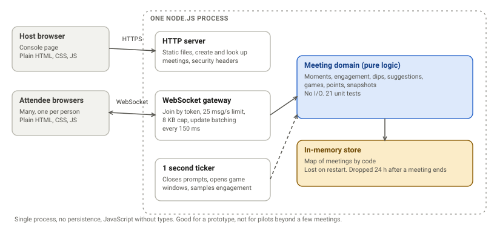
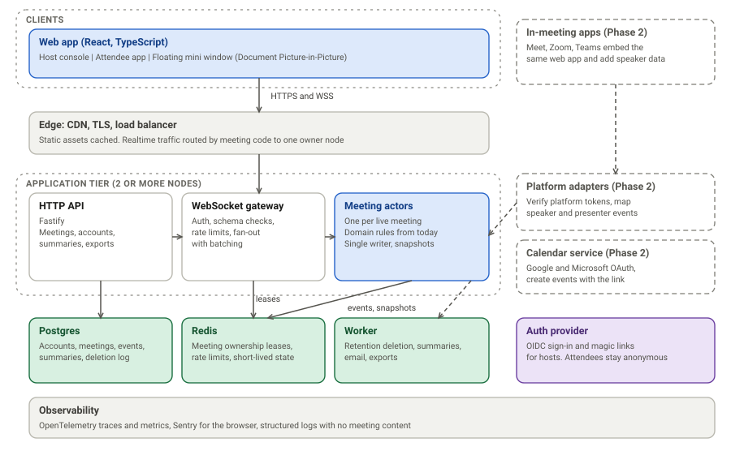
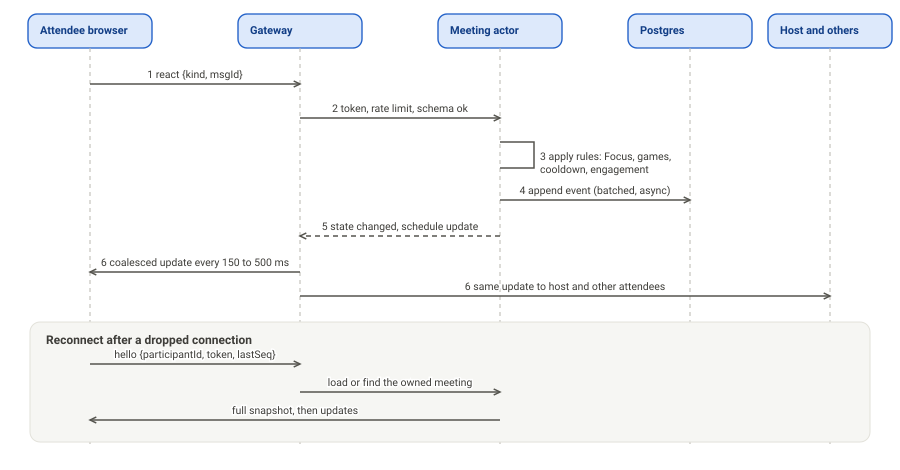
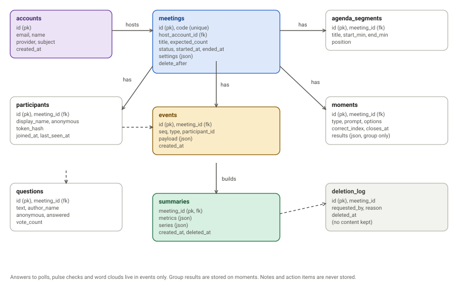
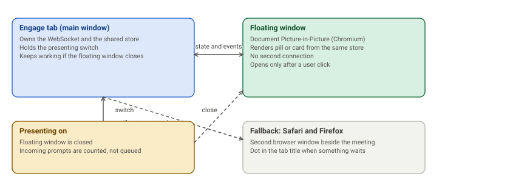

# Engage: Technical Architecture

| | |
|---|---|
| **Document status** | Draft v0.1, for review |
| **Date** | 13 October 2026 |
| **Audience** | Engineers, security reviewers, the product owner |
| **Scope** | Today's prototype, the target architecture for Phase 1.5, and the shape of Phase 2 |
| **Related** | `docs/PRD.md`, `docs/architecture/engineering-plan.md`, `docs/design/Engage-UX-UI-Design.pdf` |

**How to read this.** Statements about the current prototype were checked against the code and, where noted, measured. Everything under "Target" is a proposal. Decisions are listed as ADRs in section 15 so they can be accepted or changed one by one.

---

## 1. Summary

The prototype proves the product loop with one Node.js process, a pure domain model, and plain browser code. It works for a few meetings. It cannot survive a restart, has no accounts, and sends far more data than it needs to.

The proposed target keeps what is good (a pure domain model, a simple JSON protocol, no recording) and changes what limits growth:

1. **TypeScript end to end**, with one shared protocol package so client and server cannot disagree.
2. **One owner node per live meeting.** All changes to a meeting go through one place, which keeps rules simple and fast.
3. **Postgres as the record**, with an append-only event log and periodic snapshots, so a crashed node can be replaced mid-meeting.
4. **Smaller updates.** Send changes, not the whole state, and throttle them.
5. **Host accounts** through a managed sign-in provider, while attendees stay anonymous.
6. **A React web app** that serves the host console, the attendee view and the floating mini window from one codebase.
7. **Platform adapters** in Phase 2, so in-meeting apps can add speaker and presenter data without changing the core.

## 2. Drivers

### Requirements that shape the design

| Requirement | Consequence |
|---|---|
| Updates reach everyone within about 1 second | Persistent connections and server push. No polling |
| 5 to 50 people typical, 200 tested, 500 cap | One meeting fits on one node. Scale by adding meetings per node, not by splitting a meeting |
| Attendees need no account and no install | Anonymous participant tokens. Plain web app |
| Privacy first: no recording, little data, deletable | Minimal schema, event retention limit, no content in logs |
| Never block the meeting | Graceful degradation. Reconnect without losing identity. Server rejects, never crashes, on bad input |
| Works beside any meeting tool now, inside them later | Core independent of any platform. Adapters on the edge |
| Small team, fast iteration | Few moving parts. Managed services where they save time |

### Quality attributes, in priority order

1. **Privacy and trust.** A leak of one attendee's data to another, or any hidden tracking, defeats the product.
2. **Reliability during a meeting.** A failure in the middle of a 1 hour meeting costs trust.
3. **Low latency.** Under 1 second at the 95th percentile.
4. **Operability for a small team.** Easy to deploy, observe and roll back.
5. **Cost efficiency.** Important, but later than the four above.
6. **Extensibility.** Phase 2 integrations should not force a rewrite.

## 3. Current architecture (prototype)



| Part | Facts (checked against the code) |
|---|---|
| Runtime | Node.js 22, one dependency (`ws`), plain JavaScript, no build step |
| `server/meeting.js` | Pure domain model. No I/O. Moments, engagement, dips, suggestions, games, points, summaries, per-viewer snapshots |
| `server/index.js` | HTTP static files, create and look-up endpoints, WebSocket gateway, rate limits, 1 second ticker, update batching every 150 ms |
| State | `Map` of meetings in memory. Live meetings end after 12 hours. Ended meetings are dropped after 24 hours |
| Client | Plain HTML, CSS and ES modules. Re-renders from full snapshots |
| Tests | 26: 21 domain unit tests, 5 WebSocket integration tests |
| Security | Security headers, escaping of all user text, rate limits (25 messages per second per connection, 30 meetings per hour per address, 8 KB payload), unguessable codes, host token |

### What works well and should be kept

- **The domain model is pure.** It takes a clock and returns data. It can move into any process model unchanged.
- **Per-viewer snapshots** are built on the server, so one attendee never receives another's data. This is covered by tests.
- **The protocol is small** (host and attendee message sets of about 20 types).
- **The server is the authority.** Every rule (Focus, game windows, one answer each) is enforced on the server, not trusted from the browser.

### Limits and their consequences

| Limit | Consequence | Fix in target |
|---|---|---|
| In-memory only | A restart ends every meeting. No history. No deletion on request | Postgres, events, snapshots |
| One process | No redundancy. No rolling deploys | Multiple nodes, one owner per meeting |
| Full snapshots to everyone on every change | See the measurement below | Deltas, throttling, split messages |
| Host token in the browser's local storage | Host console works from one browser only. Clearing storage loses the meeting | Host accounts and sessions |
| JavaScript without types or schema validation | Protocol drift. Hand-written checks | TypeScript and shared schemas |
| Raw `setInterval` ticker over every meeting | Fine at tens of meetings. Wasteful at thousands | Timers owned by each meeting actor |
| No metrics, traces or structured logs | Failures are invisible | OpenTelemetry, Sentry |
| No migrations, no config management | Manual changes | Migration tool, IaC |

### Measurement: update size

Measured on the current code with 200 participants, 50 questions, one poll answered by everyone, and 120 engagement samples.

| Item | Measured |
|---|---|
| Attendee snapshot | about 10 KB, of which the question list is 9.1 KB |
| Host snapshot | about 15.6 KB |
| Time to build 200 attendee snapshots | 2.6 ms |
| One broadcast to 200 attendees | about 2 MB |
| Worst case: updates every 150 ms (6.7 per second) | about 13 MB per second for one meeting |

CPU is not the problem. **Bandwidth is.** Even a reaction, which changes nothing an attendee sees, triggers a full broadcast today. The fixes are in section 5.

## 4. Target architecture



### Components

| Component | Responsibility | Notes |
|---|---|---|
| **Web app** | Host console, attendee app, floating mini window | React, TypeScript, Vite. One bundle. Mini window renders into the picture-in-picture window |
| **Edge** | TLS, CDN for static files, load balancing | Routes realtime traffic by meeting code to the owner node |
| **HTTP API** | Accounts, meetings, agenda, summaries, exports, deletion | Fastify. Stateless |
| **WebSocket gateway** | Authenticate, validate messages against schemas, rate limit, send updates | Stateless apart from open sockets |
| **Meeting actor** | The domain model for one live meeting. Single writer. Owns its timers | Today's `Meeting` class, ported to TypeScript |
| **Postgres** | System of record | Accounts, meetings, events, summaries, deletion log |
| **Redis** | Ownership leases, rate limit counters, short-lived state | Not a source of truth. Losing it must not lose meetings |
| **Worker** | Retention deletion, summary builds, email, exports | Scheduled jobs and a small queue |
| **Auth provider** | Host sign-in (OIDC, magic link), later SAML | Managed service. Attendees never touch it |
| **Observability** | Traces, metrics, errors, logs | OpenTelemetry and Sentry |

### Design principles

1. **Single writer per meeting.** All changes to a meeting go through one actor on one node. This removes locking and races, and keeps the rules identical to today's tested domain model.
2. **The server decides.** The browser sends intent ("answer 2"), never results.
3. **Derive, don't store twice.** Engagement, dips, summaries and spread are computed from events.
4. **Group data by default.** Per-person data exists only as events with a short life. Nothing per-person is shown to the host.
5. **Fail closed on privacy, open on availability.** If a viewer's snapshot cannot be built, send nothing. If persistence is slow, keep the meeting running and catch up.
6. **Boring technology.** Use proven parts. Add complexity only when a measurement demands it.

## 5. Realtime design



### Ownership and routing

- A live meeting is owned by exactly one node. The owner is recorded as a short **lease** in Redis (renewed every few seconds, expiring after about 15).
- The load balancer routes WebSocket connections by meeting code, so all hosts and attendees of a meeting land on the owner. If a connection lands elsewhere, that node forwards it, or closes it with a redirect hint the client follows.
- If the owner dies, the lease expires, any node claims the meeting, loads the latest snapshot, replays newer events and takes over. Clients reconnect automatically.

### Protocol

Every message is a JSON envelope: `{ v: 1, t: "type", id: "client-message-id", ... }`.

| Direction | Types today (prototype) | Added in target |
|---|---|---|
| Client to server (attendee) | react, ask, upvote, respond, bingo, predict | presenting-state report (counts only), resume with `lastSeq` |
| Client to server (host) | launchMoment, closeMoment, dismissMoment, focus, games, addWindow, removeWindow, bingoWords, setPrediction, resolvePrediction, answered, removeQuestion, quiet, floor, resetClock, removeParticipant, end | agenda edit, recall check options, template apply |
| Server to client | welcome, state, error, fatal, pong | `patch` (delta), `snapshot` (full), `seq` on every message |

Rules for the protocol:

- Every client message has an `id`. The server ignores repeats, so a retry after a drop is safe.
- Every server message carries a sequence number. A client that sees a gap asks for a snapshot.
- Messages are validated against shared schemas (zod) on both ends. Unknown or malformed messages are dropped and counted.
- The protocol is versioned. Servers support the previous version for one release to allow gradual deploys.

### Smaller, calmer updates

| Change | Effect |
|---|---|
| Split the snapshot into parts (room, moment, questions, games, me) and send only the part that changed | A reaction no longer sends the 9 KB question list |
| Send small patches for counters and results | Typical update under 1 KB |
| Throttle: host 250 ms, attendees 500 ms | At most 4 and 2 updates per second |
| Page the question list (top 20, load more) | Bounded size even with 200 questions |
| Never push to a client whose view did not change | Removes most traffic |

With these, a busy 200 person meeting needs roughly 200 clients × 1 KB × 2 per second = **about 400 KB per second**, compared with up to 13 MB per second today.

### Time

The server owns time. Every state message includes server time, and the client keeps an offset so countdowns match across devices. This is already done in the prototype.

### Capacity (to be confirmed by the load test)

| Item | Planning figure |
|---|---|
| Connections per node | Up to 5,000 at 60% CPU (to verify). Memory about 50 to 100 KB per connection |
| Pilot load | 10 concurrent meetings, 500 connections |
| Early production target | 50 concurrent meetings of 200 people, 10,000 connections, on 3 nodes with room to lose one |
| Redis | Not on the per-message path. Used for leases and counters only |

## 6. Data architecture



### Storage rules

- **Events are the log.** Each action is appended with a sequence number. Writes are batched (about once per second), so a hard crash may lose up to 1 second of actions in a live meeting. This is acceptable for the product and is stated as the recovery point for live meetings.
- **Snapshots** of the meeting are written every 30 seconds and when the meeting ends. Recovery loads the latest snapshot and replays later events.
- **Summaries** are computed once when a meeting ends and keep only group-level figures (no names, no per-person actions).
- **Questions** keep the author's display name only if they did not post anonymously. Anonymous questions store no author link in anything the host or other attendees can read.
- **Never stored:** audio, video, screen content, transcripts, tab focus, notes and action items (they stay in the attendee's browser).

### Retention and deletion

| Data | Kept | Deleted by |
|---|---|---|
| Events, participants, questions, moments | 30 days after the meeting ends (configurable per account later) | Worker, nightly |
| Summaries (group figures only) | Until the host deletes them | Host, or account deletion |
| Accounts | Until the host closes the account | Account deletion flow |
| Deletion log | 1 year, with no content | Worker |
| Backups | 35 days | Automatic expiry |

A host can delete a meeting at any time, which removes events, participants, questions, moments and the summary. A deletion request is logged without content.

### Operations

- **Migrations:** a migration tool run in CI and on deploy. No manual changes.
- **Indexes:** meeting by code, events by (meeting, seq), meetings by host and date.
- **Backups:** daily snapshots with point-in-time recovery. Target recovery point 5 minutes, recovery time 1 hour.
- **Estimated size:** an event is about 200 bytes. A 200 person meeting with 3,000 actions is about 600 KB. 1,000 such meetings a month is about 600 MB, well within a small database.

## 7. Identity and access

| Actor | How they prove who they are | Can do |
|---|---|---|
| **Host** | Signs in through the auth provider (Google, Microsoft, or an emailed link). A session cookie (httpOnly, SameSite Lax, short life) | Create and manage their meetings, see group results, delete data |
| **Attendee** | Joins with a code. Receives a random participant token, stored in the browser and kept as a hash on the server | Act within one meeting. See only their own private data |
| **Platform user** (Phase 2) | A verified token from Meet, Zoom or Teams, mapped to an anonymous participant | Same as an attendee, plus automatic presenter and speaker signals |
| **Worker, API** | Service credentials with least privilege | Internal only |

- **Join codes:** six characters from a 32-letter-and-digit alphabet, about 1.07 billion combinations. Protected by per-address rate limits on lookups, expiry when a meeting ends, and monitoring of failed lookups. An optional join PIN can be added for sensitive meetings.
- **Host sessions replace the host token.** The meeting belongs to an account, so the host console works from any browser.
- **WebSockets** check the `Origin` header and the session or token before accepting a `hello`.
- **Permissions:** hosts can act on their own meetings only. Attendees can act only on themselves. The domain model already enforces who may do what, and this is verified by tests.

## 8. Client architecture

### Structure

```
packages/
  shared/     message schemas (zod), types, constants, pure helpers
  server/     API, gateway, meeting actors, workers
  web/        React app: host, attendee, mini window
  e2e/        Playwright tests
```

- **React with Vite and TypeScript.** One bundle serves the host console, the attendee app and the mini window. The wide hiring pool and mature tooling outweigh the small size advantage of lighter libraries.
- **State** comes from the server. A small store holds the latest parts. There is no client-side business logic beyond display, which keeps rules in one place.
- **Components** follow the design system in `docs/design`. Tokens stay as CSS custom properties.
- **Internationalisation:** all text in message files from the start. English only at first.

### Floating mini window



- The Engage tab keeps the connection and the store. It opens a **Document Picture-in-Picture** window on a user click and renders the pill or card into it. The floating window has no connection of its own.
- Feature detection decides what happens next: Chromium browsers get the floating window. Safari and Firefox keep Engage as a second window with a dot in the tab title when something is waiting.
- **Presenting** is a switch held by the Engage tab. When on, the floating window is closed and incoming prompts are counted, not queued.
- **Known limits:** the window can only open after a click, it can appear on a shared full screen, and the web cannot detect presenting. These are product constraints, not engineering ones, and are covered in the design and PRD.
- **Spike required:** confirm resizing, focus return, styles and event handling in the picture-in-picture window across Chrome and Edge versions.

### Performance budget

| Item | Budget |
|---|---|
| Attendee JavaScript | 120 KB gzipped or less |
| First load on a 4G connection | Under 2 seconds to interactive |
| Interaction latency | Under 100 ms to visible feedback |
| Memory | Under 100 MB for a 2 hour meeting |

## 9. Security and privacy

### Threat model (summary)

| Threat | Today | Target control |
|---|---|---|
| Guessing a meeting code | Unguessable codes, expiry | Lookup rate limits per address, monitoring, optional PIN |
| Taking over a host console | Host token in local storage | Account sessions, short-lived cookies, CSRF protection, origin checks |
| Script injection through names or questions | All text escaped, content security policy | React escaping, lint rule against raw HTML, keep the policy, add automated tests |
| Flooding and denial of service | Per-connection limit, size cap, per-meeting caps | Per-address connection caps, edge protection, backpressure |
| One attendee seeing another's data | Per-viewer snapshots, tested | Contract tests on every message type, fuzzing of snapshot builders |
| Stolen participant token | Not an issue over a single session | TLS only, tokens stored as hashes, rotate on suspicion |
| Data theft from storage | Not applicable (memory) | Encryption at rest, least privilege, short retention, no sensitive content |
| Vulnerable dependencies | One dependency | Lockfile, automated updates, vulnerability scans in CI |
| Content in logs | Minimal logging | Logging policy: no names, questions or answers in logs. Reviewed in code review |
| Clickjacking | Frames denied | Per-route policy in Phase 2, allowing only approved platform origins |
| Harassment through questions | Host can remove questions | Host can remove people, optional word filter |

### Privacy by design

- **Data minimisation:** names are optional, anonymous is supported, nothing about devices or behaviour outside Engage is collected.
- **Transparency:** the join screen lists what the host sees. A privacy summary suitable for enterprise review is part of the plan.
- **Roles:** Engage acts as a processor for customers' meeting data. Prepare a data processing agreement, a list of subprocessors and a retention statement.
- **Impact assessment:** workplace tools that can feel like monitoring warrant a data protection impact assessment. Prepare one before the first enterprise pilot.
- **Residency:** choose the hosting region from the first customer's needs. Keep the design able to run in an EU region.
- **Requests:** a person can ask for their data to be deleted. Because participants are anonymous tokens, handle this per meeting through the host and through deletion on expiry.

## 10. Infrastructure and delivery

### Environments

| Environment | Purpose |
|---|---|
| Local | One command to start everything (app, Postgres, Redis) |
| Preview | Short-lived environment per pull request |
| Staging | Production-like. Load tests run here |
| Production | Pilots and customers |

### Hosting options

| Option | Pros | Cons | Use |
|---|---|---|---|
| **Managed container platform** (for example Fly.io or Render) | Fast to set up. Good WebSocket support. Low cost | Fewer enterprise controls and regions | **Pilots** |
| **AWS** (ECS Fargate, RDS, ElastiCache) | Enterprise acceptance. Many regions. Strong controls | More setup and operations | When an enterprise customer requires it |
| Serverless functions | Cheap at idle | Poor fit for long-lived WebSockets | Not recommended |

Keep everything in containers and describe infrastructure as code (Terraform), so moving between the two is a project of days, not months.

### Networking details that matter

- WebSocket idle timeouts at load balancers are often 60 seconds. Send a ping every 25 seconds.
- Meetings last 1 to 2 hours. Platforms that cap connection lifetime need client auto-reconnect, which the client already has.
- Deploys: drain a node by telling clients to reconnect with random jitter, so a deploy never causes a reconnect storm.

### CI/CD

1. On every pull request: lint, type check, unit tests, integration tests, end-to-end tests, accessibility scan, dependency scan, bundle size check, preview deploy.
2. On merge to the main branch: build one container image and deploy to staging.
3. Production: one-click promotion from staging, with automatic rollback if health checks fail.
4. Feature flags (per account or per meeting) for risky features such as the mini window.

### Rough monthly cost, pilot scale

This is an order-of-magnitude estimate, not a quote.

| Item | Estimate |
|---|---|
| Two small app instances | US$60 to 120 |
| Managed Postgres (small) | US$30 to 70 |
| Managed Redis (small) | US$15 to 40 |
| Observability, error tracking, auth provider free tiers | US$0 to 80 |
| Domain, email, misc | US$10 to 30 |
| **Total** | **about US$150 to 400** |

## 11. Observability and operations

### Service level objectives

| Objective | Target |
|---|---|
| Availability during meetings | 99.5% for pilots, 99.9% later |
| Join success | 99% or better |
| Action to visible update | Under 1 second at the 95th percentile |
| Reconnect within 10 seconds after a drop | 98% or better |
| Meetings with no host-visible failure | 95% or better |

### What to measure

- **Meetings:** live meetings, connections per node, joins and failures.
- **Realtime:** action-to-update latency, update size, messages dropped, reconnects, lease takeovers.
- **Health:** CPU, memory, event-write lag, database latency, error rate.
- **Product (privacy-safe):** actions by type per meeting, moments launched, Focus used, presenting used, mini window opened. No content, no names.

### Operations

- Dashboards for the above, alerts on SLO burn, and a runbook per alert.
- A simple on-call rota and incident process: detect, communicate, fix, review within 5 working days.
- A public status page once there are external customers.

## 12. Testing strategy

| Layer | What | Target |
|---|---|---|
| Unit | Domain rules, engagement and dip maths, schemas | 100+ tests (21 today). Property tests for engagement and scoring |
| Contract | Every message type validated both ways. Snapshots never contain another viewer's data | Run on every build |
| Integration | WebSocket flows against a real server, Postgres and Redis | Extends the 5 existing tests |
| End to end | Playwright: host plus several attendees through the full journey, including Focus, presenting, reconnect | Core journeys on every merge |
| Accessibility | Automated scan on every page, manual screen reader pass before pilots | No serious issues |
| Load | 50 meetings of 200 people, bursts of actions, on staging | See pass criteria below |
| Resilience | Kill the owner node mid-meeting. Drop and restore Redis. Slow the database | See pass criteria below |
| Security | Dependency scan every build. Independent test before the first enterprise customer | No high-severity findings |

**Load test pass criteria.** 95th percentile action-to-update under 1 second, error rate under 0.1%, CPU under 60%, memory stable over a 2 hour run.
**Resilience pass criteria.** After killing an owner node, the meeting resumes on another node within 15 seconds, with no more than 1 second of actions lost, and clients reconnect without user action.

## 13. Phase 2: integrations

### In-meeting apps

The dashed boxes in the target diagram show where this plugs in.

Meet, Zoom and Teams each let an app run inside the meeting window as a side panel. The idea is to embed the **same web app** in that panel and add a thin adapter per platform.

```
interface PlatformAdapter {
  verify(token): Identity          // check the platform's signed token
  onSpeakerChange(cb): void        // who is speaking now
  onPresenterChange(cb): void      // who is sharing now
  meetingContext(): { id, title }  // for linking to an Engage meeting
}
```

What this unlocks:

- No pasted link and no second window.
- **Presenter detection**, so presenting mode can turn on by itself.
- **Speaker signals**, so a participation balance view becomes possible, shown as a group figure only.

What stays the same: the domain model, protocol, privacy rules and data model. Platform users map to anonymous participants.

**Spikes before committing (the details below come from memory and must be checked):**

1. For the pilot company's platform, confirm that the app can see presenter and speaker events and what the review and approval process involves.
2. Confirm the embedded browser's behaviour for WebSockets, storage and sizes.
3. Confirm the security policy changes needed to allow embedding.

### Calendar

- Google Calendar and Microsoft Graph, using OAuth with the narrowest permissions.
- Create an Engage meeting from an event, and add the link to the invite.
- Store refresh tokens encrypted. Allow disconnecting at any time.

### Explicitly not planned

Recording, transcription and any face, voice or behaviour analysis.

## 14. Migration from the prototype

Move in small steps so the product stays usable and pilots can run throughout.

| Step | Change | Result |
|---|---|---|
| 0 | Deploy the prototype as is (HTTPS, basic monitoring) | Pilot 1 can run on it |
| 1 | Add TypeScript with allow-JS. Move to a workspace layout. Add CI | Safe foundation |
| 2 | Extract schemas and types into the shared package. Validate every message | Protocol contract |
| 3 | Add Postgres, event log, snapshots. Keep the in-memory actor as the live state | Persistence and recovery |
| 4 | Add accounts and host sessions. Remove the host token | Host access from any browser |
| 5 | Split updates, add throttling and patches | Bandwidth fixed |
| 6 | Rebuild the front end in React, screen by screen, behind a flag | New app reaches parity |
| 7 | Add the mini window, recall check, agenda and coach on the new app | Phase 1 features |
| 8 | Retention jobs, security fixes, accessibility, load tests | Ready for wider pilots |

The domain model moves almost unchanged, because it has no I/O.

## 15. Architecture decisions (ADRs)

Status of all: **Proposed**.

| # | Decision | Why | Alternatives considered |
|---|---|---|---|
| ADR-1 | **TypeScript everywhere** with a shared protocol package using runtime schemas | The protocol is the main contract. One source of truth removes a class of bugs | Keep JavaScript with JSDoc. Weaker guarantees |
| ADR-2 | **Node.js 22 LTS with Fastify and `ws`** | The domain model is already Node. Small, fast, well known | Socket.IO (more features, more weight, hides behaviour). Go or Elixir (better raw concurrency, but a rewrite and a hiring change) |
| ADR-3 | **One owner node per live meeting, routed by meeting code, with a Redis lease** | Single writer keeps rules simple and tested. Scale by meetings, not within one | Shared state in Redis for every action (slower, race-prone). Managed realtime service (faster to start, adds cost, data residency and lock-in) |
| ADR-4 | **Postgres with an append-only event log and snapshots** | Recovery, summaries and deletion all come from one log. Boring and reliable | Redis only (loses data). A document database (no clear gain). Full event sourcing with rebuilds on every read (more than needed) |
| ADR-5 | **React, Vite, TypeScript** for one web app serving host, attendee and mini window | Hiring pool, tooling, good picture-in-picture rendering patterns | Preact (smaller, fewer people know it). Vanilla (does not scale to the planned UI) |
| ADR-6 | **Anonymous participant tokens. Hosts through a managed OIDC provider with magic links and later SAML** | Keeps attendee friction at zero and hosts on a secure, standard path | Build our own accounts (more risk, more time). Require everyone to sign in (breaks the product) |
| ADR-7 | **Managed container platform for pilots, AWS when a customer requires it, all as containers and Terraform** | Fast now, portable later | Serverless (poor for WebSockets). Kubernetes (too much for the team) |
| ADR-8 | **Versioned JSON envelope with sequence numbers, snapshots plus patches, idempotent client messages** | Reconnects are safe, updates are small, deploys can overlap | Binary formats (not needed at this size). GraphQL subscriptions (extra layer) |
| ADR-9 | **No recording or transcripts. Platform signals only through adapters in Phase 2** | Preserves the privacy promise and keeps the core platform neutral | Audio capture for speaker detection (privacy and consent cost) |
| ADR-10 | **OpenTelemetry and Sentry. No meeting content in logs** | Standard, portable, privacy-safe | Vendor-specific agents only |
| ADR-11 | **Feature flags per account or meeting** | Ship risky features dark and pilot with one customer | Long-lived branches |
| ADR-12 | **Retention of 30 days for events, with host-initiated deletion** | Meets the privacy promise with a clear rule | Keep forever (breaks trust). Delete at meeting end (no summaries on request, no recovery) |

## 16. Technical risks and spikes

| Risk | Likelihood | Impact | Mitigation or spike |
|---|---|---|---|
| Picture-in-picture behaves differently across Chromium versions | Medium | Medium | Spike in week 1 of that work, feature detection, fallback to the second window |
| Realtime does not scale as estimated | Medium | High | Load test early on staging with the new protocol. Keep the actor design simple |
| Owner-node failover loses or duplicates actions | Low | High | Idempotent messages, event sequence numbers, chaos test before pilots |
| Platform approval takes months | High | Medium | Start the application early. Keep the web app as the fallback |
| Rebuilding the front end delays features | Medium | Medium | Rebuild screen by screen behind a flag. Keep the old app running until parity |
| Enterprise security review finds gaps | Medium | Medium | Privacy summary, threat model, independent test before first enterprise pilot |
| Managed auth provider cost or limits | Low | Low | Isolate behind one module so it can be swapped |

## 17. Open technical questions

1. Which managed auth provider (compare SAML pricing, EU data residency, magic link support)?
2. Hosting region and data residency needs of the first customer.
3. Is a join PIN needed for the first customer, or are codes and expiry enough?
4. Which meeting platform first for the in-meeting app, and what is its review timeline?
5. Does the first customer need single sign-on for hosts at pilot time, or only later?
6. Expected peak concurrent meetings in the first six months, to size the first load test.
