# Engage in Google Meet: the whole flow, step by step

Screenshots are of the real Engage app, captured with a stand-in for Google Meet's add-on SDK. Inside Meet, the narrow panels in steps 1, 2 and 7 appear in the **side panel** opened from **Activities**. Steps 3 to 6 and 8 to 11 are normal browser pages. Names in the screenshots are made-up test names.

## Who sees what

| Person | How they get Engage | Where it appears |
|---|---|---|
| **Host** (the account that installed the add-on) | Activities, then Engage, then **Start Engage** | Meet side panel, plus the full console in a browser tab |
| **Participants with the add-on** | Activities, then Engage | Meet side panel, opens the attendee view automatically |
| **Everyone else** | The **join link** from the host | Any browser window, no add-on needed |

**Why Engage may not appear in a participant's Activities.** An add-on installed from the Google Cloud console is installed for **one account only**, the account that installed it. Other people don't see it in their Activities until it is installed for them or published to their organisation. As far as I can tell this is how Google handles add-ons in development, not a fault in Engage. I could not confirm it from Google's documentation. Until then, everyone else uses the join link. Publishing to a whole organisation needs a Google Workspace organisation, and a public listing needs Google's review. I could not confirm whether a plain personal Gmail account can publish privately.

## 1. Host opens Engage in the call and starts it

Start the Meet call, click the **nine-dot Activities icon** at the bottom right, choose **Engage**. If Engage is not running in this call, the panel offers to start it. Type a title and press **Start Engage**. The person who presses it becomes the host.

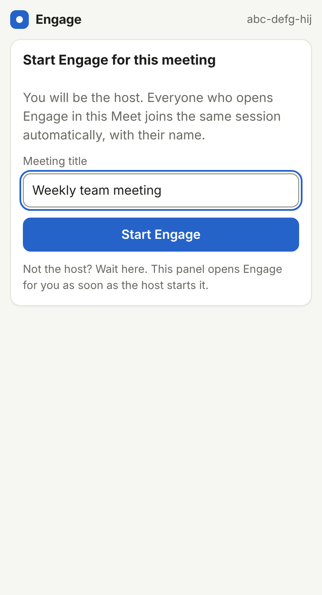

## 2. The host panel

Right after starting, the host sees the panel below. Engage also asks Meet to invite everyone in the call (the **Invite everyone in this call** button sends it again, and the panel says whether it worked). The **join link** is shown right in the panel.

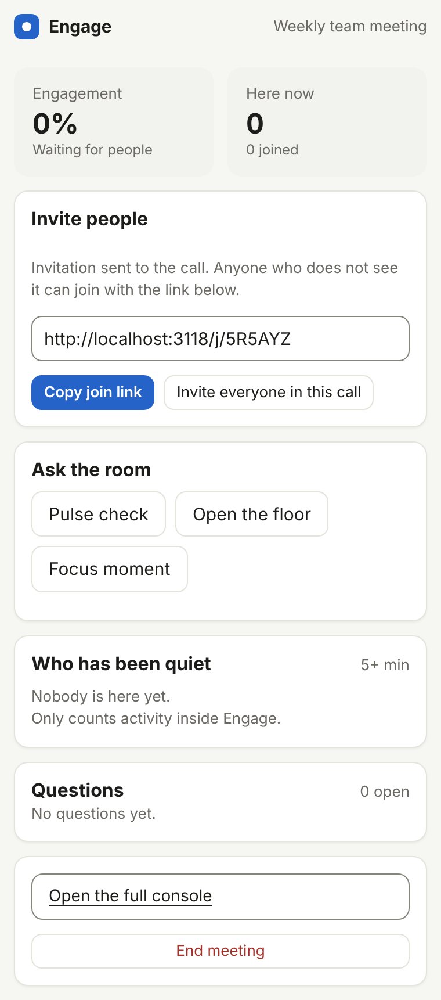

## 3. A participant opens the join link

The host presses **Copy join link** (if Meet blocks the copy, select the link in the box and copy it) and pastes it in the Meet chat. The participant opens it in any browser. They are told what the host can see and cannot see.

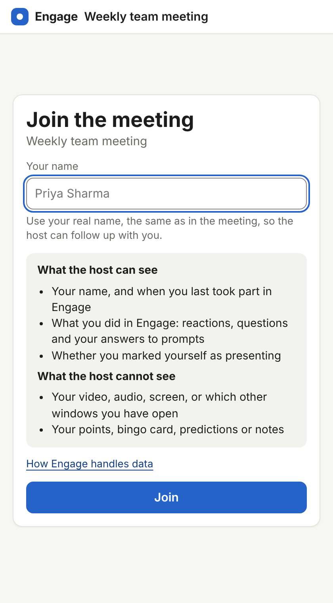

## 4. Real names are required

Placeholder names such as "Anonymous" or "Guest" are refused. The form stays open so the person can fix it.

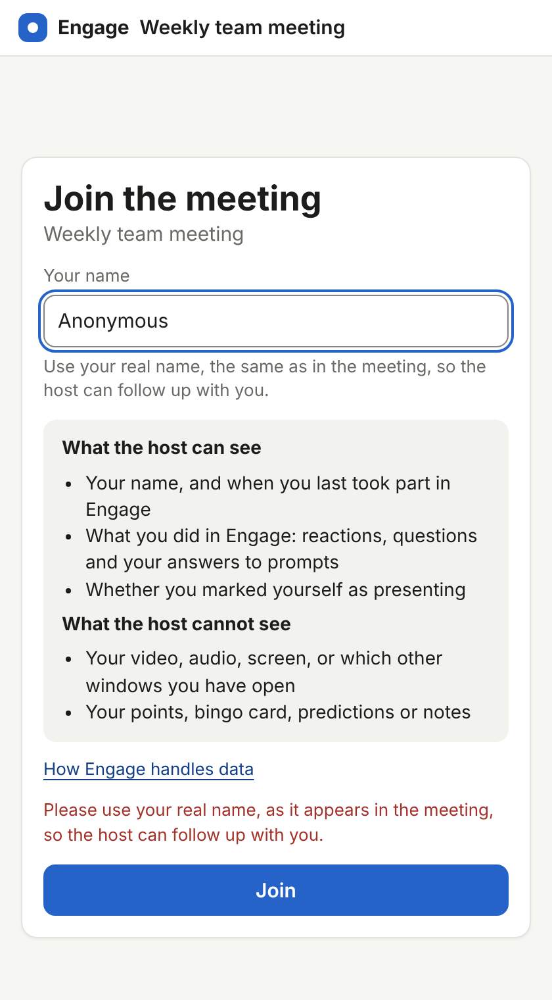

## 5. The participant's live view

Reactions, questions (shown with their name), and a private notes area. Nothing pops up over their meeting. A small **mini window** can float over the meeting on a laptop.

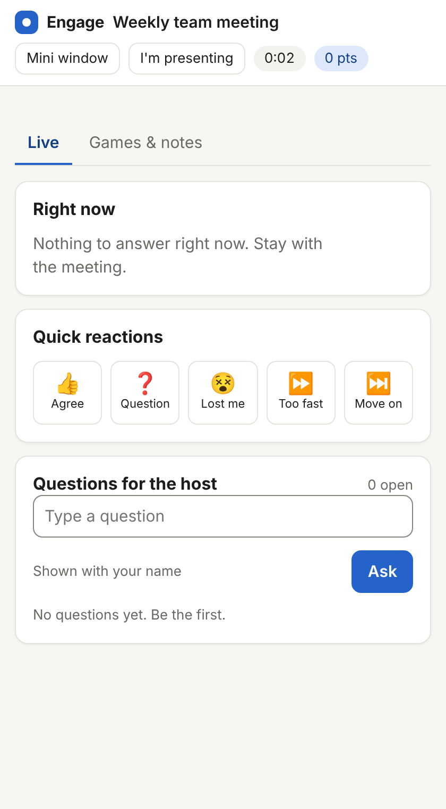

## 6. The host runs a pulse check

One tap in the host panel sends a 1 to 5 question to everyone for 45 seconds.

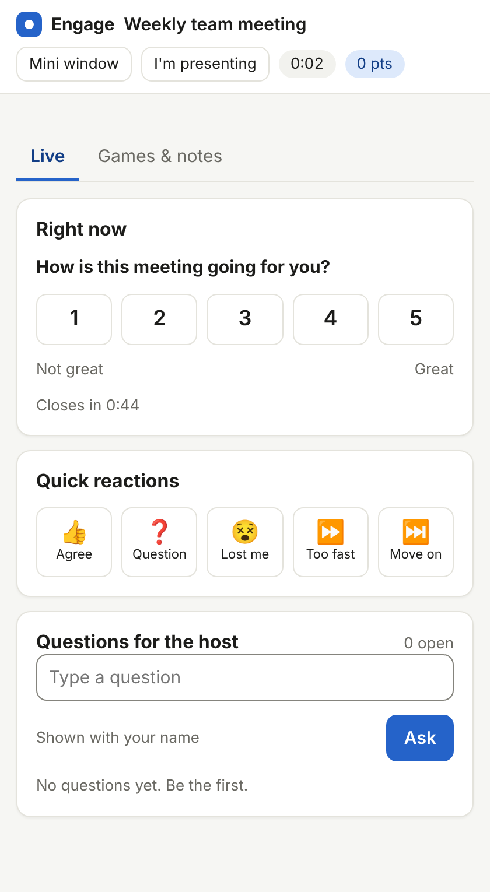

## 7. The host panel while the meeting runs

The host sees how many people are in Engage, how many answered, the questions asked, and who has been quiet. **Open the full console** opens the complete host view in a browser tab.

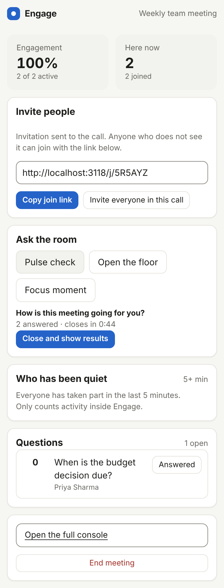

## 8. The full console on a laptop

Engagement over time with advice when it dips, who has been quiet (by name and minutes), reactions, agenda and prepared prompts, questions with pin and merge, and games.

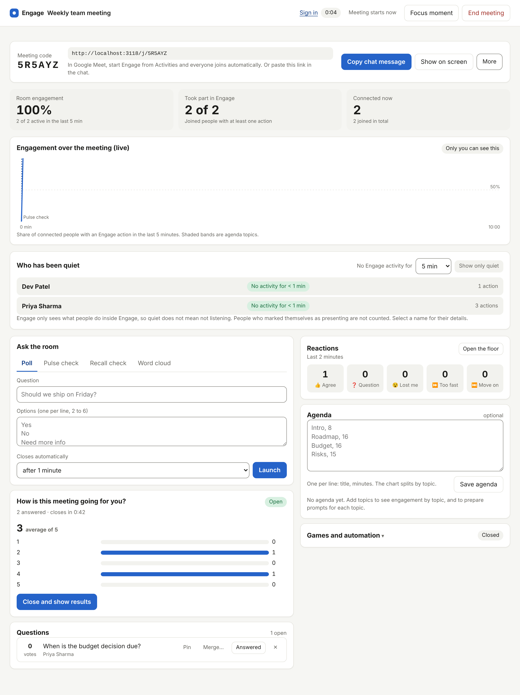

## 9. Details for one person

Select a name to see their time in Engage, quiet stretches, activity every 5 minutes, reactions, which prompts they answered (never what they chose), and their questions.

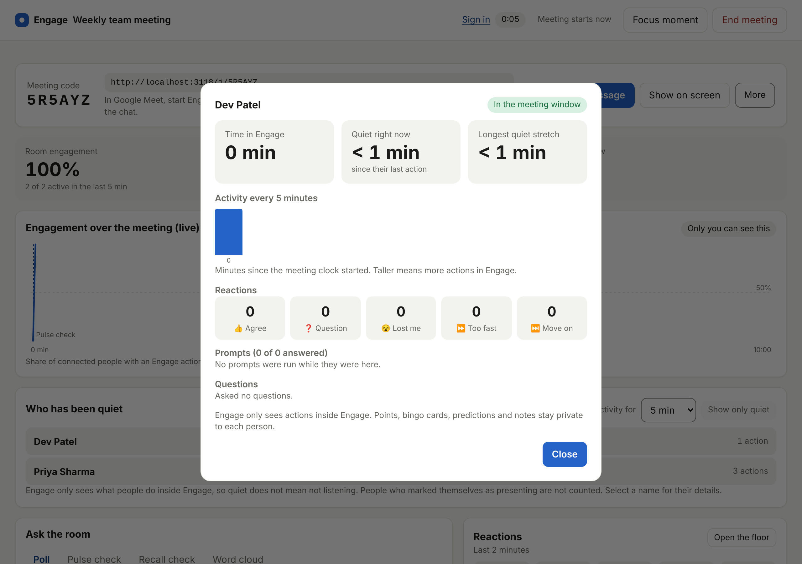

## 10. After the meeting: the host summary

The host gets a summary with engagement over the meeting, coaching advice, the people list, moments and top questions. Results can be exported as CSV.

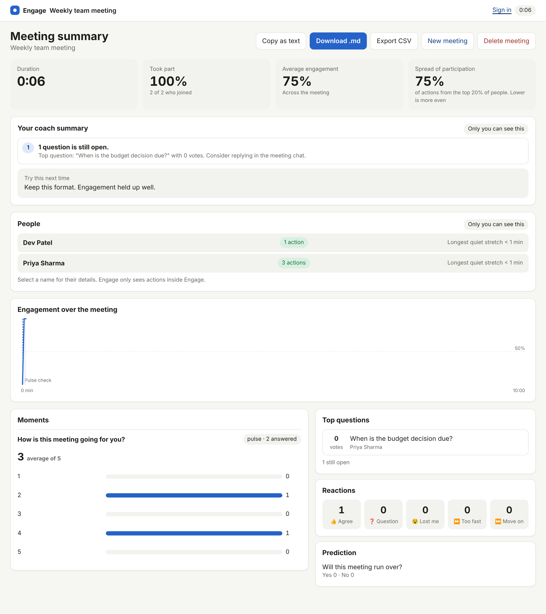

## 11. After the meeting: what a participant gets

A short recap with the prompts, the top questions and their own questions. They do not see the coaching advice or other people's activity.

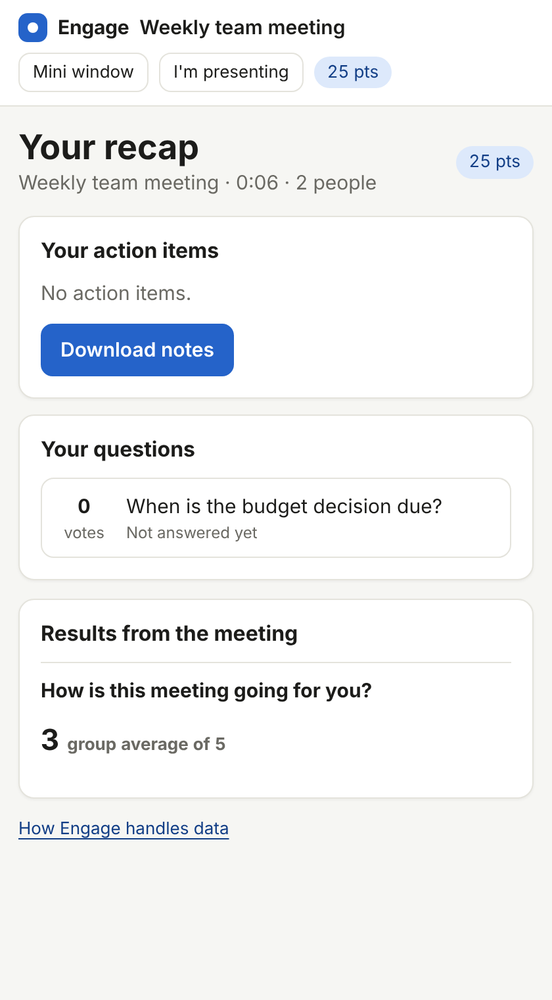

## What is tested and what is not

- **Tested in a real Meet call:** the add-on opens in the host's side panel and starts Engage.
- **Tested here with a stand-in for Meet:** every step above, including a second account in the same browser getting the attendee view and not the host view.
- **Not yet tested in real Meet:** a second person opening the panel, the invitation reaching the call, and the pulse check reaching someone inside Meet.
